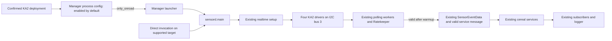

# Architecture — KA2-only `system/sensord` cleanup

**Requirements:** `reports/requirements-brief.md` · SHA-256 `6f50367f5749062cb8c7928d9b279626b04dff4f6fbf8d6265980e8ae3ff7037`  
**Confirmed intake:** `../intake/intake-brief.md` · SHA-256 `c2e026d40ff71df11fd3d0277704255c51df061bbf3ffc5c7b81187513b9dc75`; `../intake/report_grilling.md` · SHA-256 `a51313a34983497a27a5c9ddc5cdc0c9f82d725f6c8cdf382ab2dae2c75edd4e`  
**Taste:** immutable no-profile snapshot · SHA-256 `4b29408d876a909bc0a1eec35f78abf384a72276b6f6972da35e2f99a6244a8f`; canonical digest `sha256:1beb862ffc2faa7ade5f7b2308f2803bc9cea1981dbf2144ce044fa8ebd9132b`; revalidated in `reports/report_taste-snapshot-r4.md`.

## Architecture decision

Make `system/sensord` KA2-only for the user-confirmed KA2 deployment. Retain ICM42670 accelerometer, gyro, and temperature polling plus LIS2MDL magnetometer polling on I2C bus 3. Remove the TICI/tizi LSM6DS3 and MMC5603 runtime paths, GPIO 84 interrupt handling, interrupt workers, and their unused drivers and test cases.

Follow D-20 for process startup. The manager registers `sensord` as unconditionally enabled using the process type's default enabled state; preserve its existing `only_onroad` predicate. `sensord.main()` has no `KA2` platform guard. On the supported KA2 target it begins with the same realtime setup, constructs the same four sensors on bus 3 in the existing order, and keeps the existing reset/init, worker, publication, and shutdown sequence. This preserves the prior KA2 startup behavior while removing the r3 platform checks and their tests.

The KA2 event and service contracts do not change. Keep historical `SensorSource` names and ordinals `lsm6ds3 @5`, `lsm6ds3trc @10`, and `mmc5603nj @11` in `cereal/log.capnp` for old-log decoding. Keep generic manager/SCons definitions unchanged and add no runtime, dependency, or sensord-specific build target.

The confirmed deployment scope is KA2. Non-KA2 behavior is outside this design contract and is not guarded: an off-target manager or direct invocation may reach the fixed bus-3 path. That is an accepted scope limit from D-20, not a supported runtime mode or a claim of off-target safety.

## Components and ownership

| Component | Owns | Depends on | Failure behavior | Operational owner |
| --- | --- | --- | --- | --- |
| Manager process configuration | `sensord` enabled by the process default and the existing `only_onroad` predicate. It has no KA2-only selection for this process. | Manager's existing lifecycle selection and on-road state. | It is eligible while on-road and remains stopped off-road. Platform suitability is outside this deployment contract. | System manager maintainers |
| `sensord.main()` | Realtime setup, construction of the four retained sensors, reset/init order, worker lifecycle, and cleanup. No platform check is performed. | Manager launcher for managed start; local sensor drivers and bus 3 on the confirmed KA2 target. | Existing construction and initialization behavior remains: construction errors propagate; reset/init errors are logged and follow current continue behavior. | Sensord maintainers |
| Shared `Sensor` base and four retained drivers | Each sensor's bus handle, register transactions, chip check, raw conversion, event construction, warmup clock, and driver shutdown. The base opens the supplied bus in its constructor. | I2C bus 3 and the expected ICM42670/LIS2MDL devices; cereal schema. | Register/read failures follow current reset/init/poll handling. Driver shutdown writes remain best-effort as implemented. | Sensord maintainers |
| Polling workers and `PubMaster` | Per-service polling schedule, validity gate, valid cereal message construction, and publication. | One initialized driver per retained service and `SERVICE_LIST` frequencies. | Read/publish errors are logged and the loop continues; each iteration reaches `Ratekeeper.keep_time()`. Invalid warmup samples are not published. | Sensord maintainers |
| Existing cereal subscribers and logger | Consumption and recording of existing sensor services. | Stable service names, frequency, timestamp, and `SensorEventData` payload. | Existing consumer behavior; no event or schema migration is introduced. | Owners of each existing subscriber |
| Offline KA2 sensord tests and Jenkins stage | Regression proof for retained mocked KA2 behavior. | Mocked I/O and changed-path selection for the sensord suite. | Fail on a KA2 code-contract regression. Tests do not access I2C. The guard-only `test_sensord.py` and manager-gating-only assertion are removed, with no replacements. | CI and test maintainers |

## Data flow and lifecycle



On the confirmed KA2 deployment, `main()` configures realtime scheduling, constructs the ICM42670 accelerometer, gyro, and temperature sensors plus the LIS2MDL magnetometer on bus 3, resets them, then initializes them. It starts one polling worker for each successfully initialized driver. Each driver owns its bus object; the design does not share bus handles. Each polling iteration reads an event, publishes only after the existing `Sensor.is_data_valid()` window exceeds 0.5 seconds, logs caught errors, and calls its service's `Ratekeeper.keep_time()` once. Frequencies remain 104 Hz accelerometer, 104 Hz gyroscope, 25 Hz magnetometer, and 2 Hz temperature.

The gyro retains 300 ordered XYZ tuple samples, 5 ms sampling, `fmean`/population `pstdev`, existing stationary thresholds, and selected-bias behavior. This carries forward the accepted transient tuple-list memory tradeoff (about 47 KB) without approximate calibration.

On keyboard interrupt or normal worker completion, `main()` sets the shared exit event, joins live workers, then calls each retained sensor's `shutdown()`, logging shutdown exceptions and continuing. Reset failures are logged and initialization continues. An initialization failure is logged and creates no polling worker for that service. Polling failures are logged and retried on later iterations. Construction errors occur before reset/init handling and propagate, as in the existing KA2 path. These are preserved behaviors, not new recovery promises.

No GPIO 84 reads, IRQ affinity writes, interrupt timestamps, `DataNotReady` IRQ suppression, or interrupt workers remain. No TICI/tizi sensor selection or optional device-type branch remains. `sensord.main()` deliberately has no platform guard under D-20; no statement is made about manual or managed startup on a non-KA2 system.

## Interfaces

| ID | Interface | Caller → callee | Request / input | Response / output | Error behavior |
| --- | --- | --- | --- | --- | --- |
| IF-1 | KA2 on-road managed startup and direct process entry | Manager selection → `sensord.main()`; direct caller on the supported deployment → `sensord.main()` | Manager registration uses its unconditional enabled default and keeps `only_onroad`; `main()` has no platform input or `KA2` check. | On KA2, realtime setup runs first, then the existing four-driver bus-3 lifecycle publishes the existing services. | Existing construction, reset/init, poll, logging, and shutdown behavior is retained. Non-KA2 behavior is unspecified and outside scope; no platform rejection is promised. |

The full IF-1 contract and unchanged event contracts are in [the interface report](report_interfaces.md). IF-1 is an internal process-lifecycle contract; there is no HTTP/API endpoint, webhook, or new inter-service endpoint.

## Invariants and acceptance evidence

| Invariant | Enforced by | Broken when | Detection / acceptance |
| --- | --- | --- | --- |
| Runtime sensor composition is KA2-only: ICM42670 accel/gyro/temp plus LIS2MDL magnetometer, on bus 3. | `sensord.main()` composition and retained driver imports. | A non-KA2 driver, tizi device branch, alternate bus, or IRQ/interrupt code remains in runtime. | Scoped source/import audit and focused mocked KA2 tests. No hardware probing. |
| KA2 startup keeps the existing order without a platform condition. | `main()`'s existing realtime setup and sensor construction sequence. | A `KA2` guard or platform branch changes the KA2 entry path or order. | Source review of the `main()` sequence; no non-KA2 invocation test is added. |
| Managed `sensord` stays on-road and unconditionally enabled. | Default enabled state in process registration plus unchanged `only_onroad`. | A platform check is added to this process entry, or the off-road predicate changes. | Review `process_config.py`; remove the gating-only test from `test_manager.py`, without a replacement platform test. |
| KA2 event contracts and service cadence stay stable. | Driver-local event construction and current `SERVICE_LIST` definitions. | Timestamp, mapping, metadata, union, field presence, validity, service name, or rate changes. | Retained mocked event-construction and pacing tests; no hardware measurement is implied. |
| Warmup, calibration, poll errors, pacing, and shutdown retain current semantics. | Shared `Sensor`, ICM42670 gyro, polling worker, and `main()` cleanup. | Warmup publishes early; calibration math/sample order changes; caught errors stop the loop; an iteration skips `keep_time()`; or workers are not joined before shutdown. | KA2-only offline tests and review of lifecycle ordering. |
| Historical log decoding remains possible for removed sensor sources. | Unchanged `cereal/log.capnp` enum names and ordinals. | A legacy source enum is deleted or renumbered. | Schema diff shows no edit; retain all three historical identifiers. An archived-log fixture is optional future evidence. |
| CI retains offline KA2 test coverage without a Tizi hardware dependency. | Existing `HW + Unit Tests` Jenkins stage with `system/sensord/` diff-path condition. | A sensord change skips mocked tests or the old LSM/MMC hardware stage remains. | Inspect Jenkins path selection and command; suite must use mocks and no I2C. |
| Generic build behavior remains unchanged. | Existing generic `system/manager/build.py`, root `SConstruct`, and common build logic. | A sensord-specific target/dependency or unrelated build behavior is added. | Scoped diff contains no edits to shared build definitions and no new sensord target. |

### Intake path and acceptance cross-check

| Intake scope / acceptance | Implementation path boundary | Required proof |
| --- | --- | --- |
| D-12 / R-1: remove non-KA2 runtime and drivers | Edit `system/sensord/sensord.py`; delete `system/sensord/sensors/lsm6ds3_accel.py`, `lsm6ds3_gyro.py`, `lsm6ds3_temp.py`, and `mmc5603nj_magn.py`. | KA2-only import/composition audit; no IRQ or non-KA2 runtime branch. |
| D-6, D-2, D-8, D-11 / R-2–R-8 and C-1/C-2: preserve KA2 behavior and efficiency work | Keep retained drivers/configuration; preserve `test_polling_pacing.py`, `test_gyro_buffer.py`, and KA2 portions of `test_fixed_calculations.py` and `test_event_construction.py`; remove only non-KA2-only cases. | Focused mocked tests for rates/pacing, event parity, fixed calculations, calibration, errors, and cleanup. Local per-path slowdown limit remains 5%. |
| D-20 / R-9: no platform guard; keep KA2 startup order | Edit `system/sensord/sensord.py` to remove the r3 `KA2` guard and retain realtime setup before the four sensor constructors. | Review source order against the existing KA2 path. No non-KA2 guard test or device invocation. |
| D-20 / R-10: manager unconditional enabled default | Edit `system/manager/process_config.py` to remove the `KA2` enabled override for `sensord`; retain `only_onroad`. | Review process registration and predicate. Remove the gating-only assertion from `system/manager/test/test_manager.py`; do not add a replacement platform test. |
| D-20 / R-12: remove obsolete platform tests | Delete guard-only `system/sensord/tests/test_sensord.py`; remove non-KA2-only calculation/event cases and manager-gating-only test. | Remaining offline suite covers KA2 behavior; no test asserts non-KA2 rejection or platform gating. |
| D-14/D-17 / R-11/C-3: historical source compatibility | No edit to `cereal/log.capnp`. | Confirm `lsm6ds3 @5`, `lsm6ds3trc @10`, and `mmc5603nj @11` remain unchanged. |
| R-13: remove stale TICI process expectations | Remove TICI sensord CPU budget from `selfdrive/test/test_onroad.py`; change `system/loggerd/tests/test_encoder.py` so TICI/tizi logger rotation does not start/stop sensord; preserve loggerd assertions and KA2 process coverage. | Audit scoped references; KA2 mapping/budget remains untouched. |
| D-15/D-19 / R-14/R-15: simplify CI; keep generic build untouched | Remove dedicated `LSM + MMC` / `tizi-lsmc` Jenkins stage; run mocked suite in existing `HW + Unit Tests` conditionally on `system/sensord/`. No edit to `system/manager/build.py`, root `SConstruct`, or common build logic. | Inspect Jenkins path filter and command; no new target/dependency. |

No unrelated worktree paths are in scope. D-20 confirms the deployment platform, but board revision, sensor identity, physical startup/cadence, and target CPU/RSS remain unverified. No hardware or I2C access was performed or authorized.

## Trust boundary and data handling

| Boundary | Untrusted input | Privileged action / asset | STRIDE notes |
| --- | --- | --- | --- |
| Local KA2 I2C devices → `Sensor`/drivers | Register bytes and device readiness from the physical ICM42670 and LIS2MDL; identity uses existing chip-ID reads. | Process access to bus 3; no credentials or secrets are handled. | **S:** unexpected device data is constrained by existing chip-ID checks, not cryptographic identity. **T:** bus/register values can be wrong or corrupted. **R:** existing logs provide operational evidence, not per-sample audit. **I:** measurements remain visible to local subscribers. **D:** missing-device/read faults can suppress or interrupt data under existing handling. **E:** no privilege transition is designed. |
| Manager/direct entry → `sensord.main()` | Local manager state or local process invocation. There is no platform check under D-20. | Starting the realtime daemon and opening bus 3. | **S/T:** local software configuration is trusted within the confirmed KA2 deployment. **R:** manager and sensor logs remain. **D:** off-target invocation is outside scope and may reach bus 3; D-20 removes platform rejection. **E:** no authorization surface is added. |
| `sensord` → local cereal consumers | Constructed sensor values and timestamps. | Local publication on existing cereal services. | **S/T:** no remote publisher or new crossing is added. **R:** existing logging remains. **I:** readings remain available to local services as before. **D:** polling faults may reduce updates. **E:** no privilege boundary is added. |

The change removes a local platform-deny condition, but adds no remote input, authentication, sensitive-data store, or dependency. Security-builder will assess this r4 architecture before the design gate; Commander must package that updated security seed rather than carry forward the r3 record without review.

## Technology rationale and tradeoffs

| Choice | Alternative rejected | Rationale | Reversible? |
| --- | --- | --- | --- |
| Keep the current Python daemon, shared `Sensor` base, four retained drivers, `PubMaster`, and cereal services. | Add a runtime, generic device registry, event abstraction, or service endpoint. | The approved work removes the obsolete platform branch; no new abstraction or endpoint solves a requirement. | Yes; code-only. |
| Use the process registration's unconditional enabled default and preserve `only_onroad`; remove the direct-entry `KA2` guard. | Retain manager and `main()` platform checks. | D-20 confirms the KA2 deployment and explicitly chooses fewer platform checks while preserving the current KA2 startup order. | Yes; a future non-KA2 deployment requires a new approved design. |
| Keep I2C bus 3 and the four-driver polling model. | Retain a TICI/tizi bus switch or add bus discovery. | D-20 fixes the confirmed KA2 path; discovery is not requested and would add behavior. | Yes; future hardware support requires a new approved scope. |
| Preserve driver-local event constructors and exact published payloads. | Change shared cereal schema or normalize fields through a helper. | Consumer, log, default-field, and payload compatibility remain requirements; prior comparisons favored local construction. | Yes; a separate interface change needs approval. |
| Preserve generic manager/SCons build behavior; change only scoped Jenkins test selection. | Add sensord targets/dependencies or rewrite common build logic. | Intake found no generic sensord target; only CI selection changes. | Yes; scoped Jenkins edit. |

## Non-functional targets and limits

| Target | Number | Mechanism / evidence | Unproven? |
| --- | --- | --- | --- |
| KA2 service frequency | Accelerometer 104 Hz; gyroscope 104 Hz; magnetometer 25 Hz; temperature 2 Hz. | Existing `SERVICE_LIST` and per-service `Ratekeeper`; offline pacing tests prove code path only. | Live target cadence is unproven. |
| Sensor warmup | No event until the existing 0.5-second validity window passes. | `Sensor.is_data_valid()` gate in each polling loop. | Physical startup timing is unproven. |
| Gyro calibration | 300 samples at 5 ms intervals with current statistical thresholds. | Retained ICM42670 implementation and deterministic offline test. | Actual stationarity and target initialization duration are unproven. |
| Allowed local event-path slowdown | No individual path >5% slower under the declared local comparison. | Inherited D-8 comparison rule; repeat only if implementation changes an event path. | Not a target CPU guarantee. |
| KA2 startup / CPU / RSS | No numeric target set. | No board/sensor identity or accepted target baseline/window. | Yes; defer target signoff and performance claims until target owner supplies an authorized rig and baseline. |

## Decision register

The confirmed intake is authoritative. D-20 supersedes D-13, D-18, and the guard-only test portion of D-16; other listed decisions remain in force.

| ID | Status and architecture choice | Source | Owner | Reopen trigger |
| --- | --- | --- | --- | --- |
| D-1 | Superseded prior KA2 plus TICI/tizi behavior boundary with KA2-only runtime scope. | prior-artifact | design/commander | A new approved platform-scope request. |
| D-2 | Retain approved polling pacing, fixed calculations, tuple-list calibration, and direct event construction. | prior-artifact | build/build-management | Scoped parity or benchmark failure. |
| D-3 / D-7 | Defer target startup and CPU/RSS measurements; no target identity or baseline is available. | prior-artifact | KA2 target owner with build/build-management | Before device validation or any target-performance claim, after rig and window are agreed. |
| D-4 / D-5 | Keep separate polling workers and bus handles; keep exact gyro statistics, not an online approximation. | prior-artifact | design/commander | Separately approved scheduling, bus, or numerical change. |
| D-6 / D-12 | Preserve the four KA2 sensors and current behavior; remove non-KA2 runtime drivers and IRQ handling. | user | build/build-management | New approved hardware or platform scope. |
| D-8 / D-9 / D-10 | Prefer fewer lines when behavior is equal; reject shared or nested event construction when it adds lines or slows paths. | user / prior-artifact | build/build-management | New measured candidate with parity. |
| D-11 | Keep 300 ordered gyro tuples, accepting about 47 KB temporary storage. | user | build/build-management | Separate numerical redesign with parity evidence. |
| D-13 | **Superseded by D-20:** no `enabled=KA2` manager override; `sensord` uses the unconditional enabled default and keeps `only_onroad`. | user (superseded); D-20 user | build/build-management | New process-lifecycle decision. |
| D-14 / D-17 | Retain legacy source enums and ordinals in `cereal/log.capnp`. | codebase / prior-artifact | design/commander | Separate schema migration with archive-decoding plan. |
| D-15 / D-19 | Remove Tizi sensor hardware CI stage; run mocked suite in generic HW + Unit Tests on `system/sensord/` changes; keep generic manager/SCons files unchanged. | codebase / delegated-default | build/build-management | Evidence of a path-filter miss or independent build-target requirement. |
| D-16 | **Partly superseded by D-20:** retain KA2 mocked cases and remove non-KA2-only tests; delete the r3 guard-only `test_sensord.py`; remove the manager-gating-only assertion. | user; D-20 user | build/build-management | New approved test scope. |
| D-18 | **Superseded by D-20:** no direct-entry `KA2` guard; preserve the existing KA2 startup order. | delegated-default (superseded); D-20 user | build/build-management | New approved process-entry policy. |
| D-20 | Confirm deployment target KA2; remove platform checks, make manager sensord unconditionally enabled, retain `only_onroad`, preserve KA2 startup order and behavior, and delete guard/gating-only tests. | user | build/build-management | A new deployment target or behavior requirement. |

## Open decisions and risks

| Open item | Severity | Blocks | Owner | Latest safe decision point |
| --- | --- | --- | --- | --- |
| Confirm the KA2 board revision and sensor identity; agree on a target startup/cadence/CPU/RSS measurement window. | Major | Hardware signoff and target-performance claims only; not offline design/build. | KA2 target owner with build/build-management | Before device validation or any target claim. |
| Provide a representative historical log containing LSM/MMC enum values for end-to-end decode proof. | Minor | Optional archive-fixture proof only; enum preservation is fixed. | Log owner with build/build-management | Before merge if archive evidence is required. |
| Non-KA2 runtime and direct invocation are not guarded under D-20. | Info | Non-KA2 use only; outside the confirmed KA2 deployment contract. | Admiral / platform owner | Before any future non-KA2 deployment is considered. |
| Local harness Python 3.12.3 is below the harness minimum 3.13; hooks are missing. | Info | Harness-dependent lifecycle checks only. | Admiral/operator | Before lifecycle checks that require the supported environment. |

## UI applicability

```yaml
applicable: false
reason: no user-facing surface - design system not engaged
scope: design-to-build
decided_by: architect
```

This sensor daemon and its machine consumers expose no screen, visual surface, or end-user interaction.
